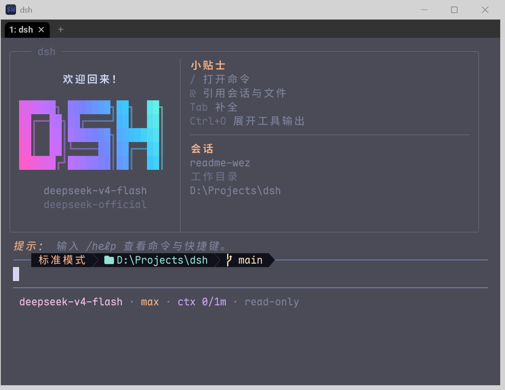
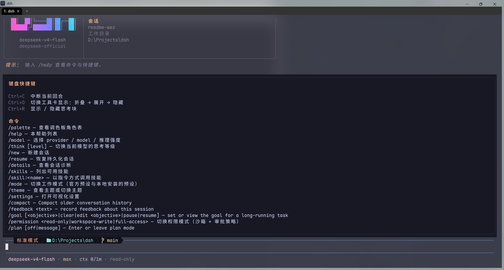

<div align="center">

# dsh-omp-tui

**OMP 风格的 DeepSeek Harness（dsh）终端界面**

[](LICENSE)
[](#变更记录)
[](#运行要求)
[](CONTRIBUTING.md)

</div>

---

## 简介

**dsh-omp-tui** 是 DeepSeek Harness（dsh）的独立 profile bundle（插件），负责终端呈现、输入交互与会话相关的 TUI 能力；agent、模型、工具、持久化和沙箱仍由 dsh harness 提供。

目前本项目正在迁移并合并 DeepSeek Harness 社区发起的公开适配器支持，正在向社区公开的 [`@dsh-std/adapter-dsh`](https://www.npmjs.com/package/@dsh-std/adapter-dsh) 与 dsh-ecosystem-spec v0.15 插件准入规范迁移；详细说明见 [社区适配器迁移说明](#社区适配器迁移说明)。

它内置了 OMP 风格的 Catppuccin 主题、会话与快捷键体系、`/model` 与 `/permission` 等斜杠命令，以及从 OMP 迁移来的微信桥插件（WeChat iLink），可直接通过 `dsh --profile tui` 启动使用。

> [!IMPORTANT]
> **维护状态说明**
>
> - 项目目前已经可以作为 TUI 工具正常使用，必要功能均已测试通过。
> - wechat-claw 通道的远程控制能力已开发完成。
> - 由于本人近期发现利用dsh万物皆插件的性质+本地部署小模型或者接入其他低价模型，用来处理一些日常任务好像可以达成很不错的效果，可以随便定制自己想要的功能，因此本人准备继续缓慢维护该项目，只解决个人需求，如有其他功能需求，可以提交issue。

## 目录

- [简介](#简介)
- [界面预览](#界面预览)
- [功能概览](#功能概览)
- [安装](#安装)
- [启动与日常使用](#启动与日常使用)
- [配置](#配置)
- [开发](#开发)
- [项目结构](#项目结构)
- [社区适配器迁移说明](#社区适配器迁移说明)
- [变更记录](#变更记录)
- [相关文档](#相关文档)
- [许可](#许可)

## 界面预览

截图来自本机 WezTerm 中实际启动的 `dsh --profile tui`。演示实例未配置 API key，因此截图聚焦于启动页、状态栏和内置帮助面板，不代表模型响应效果。

<p align="center">
  
  <br>
  <sup>欢迎页</sup>
</p>

<p align="center">
  
  <br>
  <sup>输入 <code>/help</code> 可查看快捷键和命令</sup>
</p>

工具卡支持折叠、展开和隐藏；助手正文、思考块、上下文卡和 `Output` 分隔栏使用独立的视觉层级。

## 功能概览

| 功能 | 说明 |
|---|---|
| 🎨 OMP 风格 TUI | 默认 Catppuccin 动态深浅主题、truecolor、Nerd Font 图标和简洁双横线编辑区 |
| 📐 响应式布局 | 工作目录固定在编辑器下方左侧，权限模式右对齐；模型、思考强度与 `ctx` 独立成行，窄终端优先保留权限与上下文 |
| 💬 会话管理 | 支持新建、命名、恢复和进程内切换持久化会话 |
| ⏱️ 插话队列 | 生成中按 `Enter` 把消息加入插话队列，在下一步（通常在工具调用完成后）送达模型；`Alt+Up` 编辑未生效插话并取消排队 |
| 🧠 模型与思考等级 | 通过 `/model`、`/think` 选择 provider、model 和 reasoning effort |
| 🔀 工作模式 | 支持 dsh 官方 `standard`、`minimal`、`code`、`cordis` 预设，也能发现本地安装的 agent preset |
| 🔐 权限模式 | 通过 `/permission` 在 `read-only`、`workspace-write`、`full-access` 等部署可用预设间切换 |
| 🌗 主题与本地化 | 移植本机 OMP 全部 98 个具体主题（`dark-*` / `light-*` / 中性主题），支持动态（深浅色槽位独立）与选定（单一主题）两种模式；支持逐角色 RGB 覆盖；内置 `zh-CN` 与 `en` |
| ⌨️ 命令与补全 | 支持斜杠命令、`@` 会话/文件引用、路径补全和参数补全 |
| 💚 微信桥 | 扫码登录、白名单/配对码、`@dsh` 远程命令、进度/结果推送、`wechat_send` / `wechat_status` 工具 |

## 安装

### 运行要求

| 项目 | 要求 |
|---|---|
| Node.js | `^22.19.0` 或 `>=24.0.0` |
| pnpm | `11.7.0` 或兼容的 pnpm 11 |
| dsh | `0.1.1-rc.2`（开发钉死）或 `0.1.2-alpha.2/3`（std adapter 覆盖线） |
| 终端 | 推荐支持 truecolor；使用 Nerd Font 可获得完整图标显示 |

> [!NOTE]
> 当前 dsh 仍处于 developer preview。首次安装建议固定 dsh 版本和插件 release tag。

### 从 GitHub Release 安装

没有 pnpm 时先安装固定版本：

```sh
npm install --global pnpm@11.7.0
```

然后安装当前 release tarball：

```sh
npx --yes @deepseek-ai/dsh@0.1.1-rc.2 plugin --profile tui add \
  https://github.com/mytianyi0712/dsh-tui-plugin-OhMyPi/releases/download/v0.3.0/dsh-omp-tui-0.3.0.tgz
```

tarball 已包含构建后的 `lib/`，用户机器无需编译本项目。

### 从 GitHub tag 安装

Git 安装会执行本项目的 `prepare` 构建。pnpm 11 默认阻止依赖构建脚本，因此必须显式允许本包：

```sh
npx --yes @deepseek-ai/dsh@0.1.1-rc.2 plugin --profile tui add \
  --allow-build=dsh-omp-tui \
  github:mytianyi0712/dsh-tui-plugin-OhMyPi#v0.3.0
```

固定 tag 比直接使用 `#main` 更容易复现。完整的升级、卸载和安装排障说明见 [`docs/INSTALL.md`](docs/INSTALL.md)。

### 全局安装启动器

如果希望直接使用 `omdsh` 启动器，也可以全局安装本地 tarball；包内的 dsh 宿主 peer 依赖为 optional，npm 11 不会因 peer 图触发 Arborist 的 `null.children` 崩溃：

```sh
npm install --global ./dsh-omp-tui-0.3.0.tgz
npm install --global @deepseek-ai/dsh@0.1.1-rc.2
omdsh
```

> [!NOTE]
> `omdsh` 只负责调用 PATH 中的官方 `dsh`；若未安装官方 dsh，会显示 `dsh is not recognized`。

## 启动与日常使用

### 启动会话

```sh
# 使用 npx
npx --yes @deepseek-ai/dsh@0.1.1-rc.2 --profile tui
npx --yes @deepseek-ai/dsh@0.1.1-rc.2 --profile tui --session my-id
npx --yes @deepseek-ai/dsh@0.1.1-rc.2 --profile tui --resume <session-id>

# 已安装 dsh launcher 后
dsh --profile tui
dsh --profile tui --session my-id
dsh --profile tui --resume <session-id>
```

`--resume` 与 `--session` 互斥。新会话只有在首次产生用户消息、助手消息或工具调用后才会落库；空白会话不会出现在 `/resume` 列表中。

### 快捷键

| 快捷键 | 作用 |
|---|---|
| `Esc` | 中断当前回合 |
| `Enter` | 空闲时发送；生成中把当前消息加入插话队列 |
| `Ctrl+C` | 空闲时清屏 / 运行中中断；2 秒内再次按下退出程序 |
| `Ctrl+D` | 编辑器为空时退出程序 |
| `Ctrl+T` | 显示 / 隐藏思考块 |
| `Ctrl+O` | 展开 / 折叠工具输出 |
| `Ctrl+Shift+O` | 显示 / 隐藏工具活动卡 |
| `Alt+L` | 重置终端显示 |
| `Alt+Up` | 编辑下一条尚未生效的插话（自动取消排队） |
| `Ctrl+P` / `Shift+Ctrl+P` | 循环切换模型（Shift 反向） |
| `Alt+M` | 打开模型选择器 |
| `Ctrl+Q` / `Ctrl+Enter` | 提交当前草稿（生成中为插话） |
| `PageUp` / `PageDown` | 翻页滚动 transcript |
| `Tab` | 补全当前斜杠命令、参数或路径 |
| `@` | 开始会话或文件引用补全 |

### 常用命令

| 命令 | 作用 |
|---|---|
| `/help` | 查看快捷键和完整命令列表 |
| `/model` | 选择 provider、model 和 reasoning effort，并持久化设置 |
| `/think [level]` | 切换当前模型的思考等级；无参时循环切换 |
| `/new` | 在当前项目、模型和权限模式下新建会话 |
| `/resume [id]` | 列出或切换当前项目的持久化会话 |
| `/details` | 查看会话标题、目录、模型、agent、tokens 和 context |
| `/mode [preset]` | 切换 dsh agent 组合；无参时循环切换 |
| `/permission [preset]` | 切换沙箱和审批策略 |
| `/theme [mode\|dark\|light\|theme id]` | 查看或切换主题模式与主题 |
| `/palette` | 查看当前主题实际使用的颜色角色 |
| `/settings` | 打开可视化设置 |
| `/skills` | 列出可用技能 |

`@[label](dsh-session:…)` 会把目标会话的模型可见快照注入当前会话；具体 URI 由输入 `@` 触发补全生成。更多命令以运行中的 `/help` 为准。

### 微信远程桥接（WeChat iLink）

本 bundle 内置了从 OMP 迁移来的微信桥插件：通过腾讯官方 ClawBot / iLink 通道，把 dsh 会话连接到微信，支持扫码登录、白名单/配对码、远程 `@dsh` 命令、自动进度汇报与结果推送、`wechat_send` / `wechat_status` 工具，以及 ask 提问同步推送到微信。

```sh
# 在 dsh TUI 中扫码登录
/wechat-login

# 陌生微信用户会收到 6 位配对码，在 dsh 中批准
/wechat-pair 123456

# 查看桥状态
/wechat-status
```

微信里以 `@dsh` 开头的消息会被当作远程命令，不会进入会话（例如 `@dsh status`、`@dsh models`、`@dsh think max`、`@dsh notify on`）。`@dsh chat` 会切换到 chat 模式：之后的所有普通微信消息都实时分段回传模型文本，且不会注入进度汇报。`@dsh work` 会切换回 work 模式：之后的所有普通微信消息都在任务结束后回传完整结果，并按进度配置汇报。所有 `@dsh` 远程命令仅限微信侧调用，不会出现在本地 `/help`、命令补全菜单中，也无法在本地以 `/dsh-*` 形式执行。模型可用 `wechat_send` 工具回复。

状态目录：`~/.dsh/wechat-ilink/`（可用环境变量 `DSH_WECHAT_ILINK_STATE` 覆盖）。登录二维码同时写入 `~/.dsh/wechat-ilink/login-qr.txt`，方便无界面场景查看。

#### 微信推送

微信桥支持把任务进度与结果自动推送到微信：

- **微信 work 模式**：`@dsh work` 切换后，所有普通微信消息都会在任务结束后发送结果。模型回合每达到配置的间隔轮数时，会向微信推送一次进度。
- **微信 chat 模式**：`@dsh chat` 切换后，所有普通微信消息在生成期间实时回传可见文本，不推送周期进度，也不会在结束时重复发送完整结果。
- **终端任务也推送**：默认关闭。使用 `/wechat-notify on` 开启后，终端发起的任务也会在进度/完成时推送到微信；`/wechat-notify off` 关闭。
- **可视化配置**：在 `/settings` 的 `微信claw` 标签页中可配置：
  - 进度汇报：开 / 关
  - 进度汇报间隔（轮）
  - 终端任务推送微信：开 / 关

配置保存在 `~/.dsh/wechat-ilink/config.json`，可通过环境变量 `DSH_WECHAT_ILINK_STATE` 改变状态目录。

### 使用 `omdsh` 启动 TUI

项目提供 `omdsh` 启动器（`scripts/omdsh.js` 为跨平台 bin，另有 `scripts/omdsh` 与 `scripts/omdsh.cmd`）。`omdsh` 会调用系统 PATH 中的官方 `dsh` 并启动 `--profile tui`；本项目不下载、不缓存 dsh。正常启动不打印日志、不迁移配置、不自动升级；首次尚无 tui profile 时会静默安装当前启动器包（可用 `OMDSH_NO_BOOTSTRAP=1` 跳过）。从 GitHub 获取新版本并做适配请使用 `omdsh update`。官方 dsh 命令（`web`、`plugin`、显式 `--profile` 等）请直接使用 `dsh`。

```sh
# 开发环境：把仓库 scripts 目录加入 PATH
export PATH="$HOME/dsh-omp-tui/scripts:$PATH"   # Git Bash / zsh
omdsh                         # 等价于 dsh --profile tui
omdsh --resume <session-id>   # 透传给 tui profile
omdsh update                  # 从 GitHub Release 安装最新包并适配

# Windows cmd / PowerShell
# 将 <仓库>\scripts 加入 PATH，或直接运行 <仓库>\scripts\omdsh.cmd
```

安装发布包后，`omdsh` 会由 `bin` 入口安装到 profile 的 `.bin` 目录（例如 `~/.dsh/profiles/tui/node_modules/.bin/omdsh`），把该目录加入 PATH 即可直接使用。

需要指定真实 dsh 可执行文件时设置 `DSH_REAL`；设置 `DSH_DEBUG=1` 可以只打印启动器解析出的命令，不启动 dsh。

## 配置

### 模型连接

官方 DeepSeek API：

```sh
# Git Bash / zsh
export DEEPSEEK_API_KEY='your-key'

# PowerShell
$env:DEEPSEEK_API_KEY = 'your-key'
```

本地 OpenAI-compatible 网关：

```sh
# Git Bash / zsh
export DEEPSEEK_BASE_URL='http://localhost:3000/v1'

# PowerShell
$env:DEEPSEEK_BASE_URL = 'http://localhost:3000/v1'
```

环境变量必须在启动 dsh 的同一个 shell 中可见。启动后可用 `/model` 选择并持久化 provider、model 和思考等级。

### TUI profile 配置

在 profile 的 `cordis.patch.yml` 中配置 `id: tui` 行，或使用 dsh settings 注入同一配置：

```yaml
- id: tui
  config:
    mode: standard              # standard | minimal | code | cordis 或本地 preset id
    locale: zh-CN               # zh-CN | en
    defaultReasoningEffort: max
    theme:
      mode: dynamic            # dynamic | selected
      dark: dark-catppuccin    # 深色槽位主题
      light: light-catppuccin  # 浅色槽位主题
      selected: dark-catppuccin # selected 模式的单一主题
      custom:
        accent: [255, 100, 100]
        userMessageBg: [24, 24, 37]
```

- `mode` 只对空白会话生效；切换结果会写入会话日志，恢复会话时沿用。
- `/theme` 和 `/settings` 的选择在存在官方 settings provider 时写入 `$DSH_HOME/settings.yaml`。
- `/settings` 分为“常规 / 模型与供应商 / 高级 / 微信claw”四页；模型与供应商页支持新增/编辑供应商、模型探测与手动模型列表。接口类型使用 dsh-llm-pi-ai 官方值：OAI 兼容 `openai-completions`、Response `openai-responses`、Message `anthropic-messages`。
- 默认模式会读取 dsh settings 中保存的 `agent-presets.default`：设置页修改后，新会话启动会使用该默认模式，而不是固定回退到 `standard`。
- `theme.custom` 只接受 RGB 三元组；未知角色和非法值会被忽略。
- `theme.mode` 可选 `dynamic`（动态，按终端明暗在 `theme.dark` / `theme.light` 之间切换）或 `selected`（选定，固定使用 `theme.selected`）。三个主题槽位均填写具体 OMP 主题 id，不校验主题自身明暗，可任意搭配。
- `/permission` 的可用选项以当前部署的权限预设为准，自定义 preset 也会进入命令提示和补全。

## 开发

```sh
pnpm install
pnpm run check        # verify:boundary + verify:contract + verify:plugin-spec + typecheck + test
pnpm run prepare
```

门禁说明（dsh-ecosystem-spec v0.15 / `@dsh-std/adapter-dsh` 动态链接）：

| 命令 | 作用 |
|---|---|
| `pnpm run verify:boundary` | `@dsh-std/adapter-dsh` 只允许在 `src/dsh-adapter/` 内 import；`@deepseek-ai/*` 只允许在 `src/dsh-host/`（宿主渲染接缝）内 import |
| `pnpm run verify:contract` | 校验 `@dsh-std/{core,manifest}` 与框架 major；DSH harness 版本由 std adapter 吸收 |
| `pnpm run verify:plugin-spec` | 用官方 `@dsh-std/manifest` 校验 `dsh-plugin.json` 并构建 Host Descriptor |

常用辅助命令：

```sh
node --experimental-transform-types scripts/perf-probe.ts
```

测试使用 Node 原生 `node:test` 运行 `.ts` 文件，不依赖兄弟 harness checkout。修改源码后重新运行 `pnpm run prepare`，再使用 `link:` profile 验证：

```sh
npx --yes @deepseek-ai/dsh@0.1.1-rc.2 plugin --profile tui add link:.
```

社区 std adapter（`@dsh-std/adapter-dsh`）由 profile 动态链接，不打进本包。`omdsh update` 会在升级时尝试把它装进 tui profile；也可以手工安装：

```sh
dsh plugin --profile tui add @dsh-std/adapter-dsh
```

装上后本 TUI 会通过 `dsh-omp-tui/std-adapter` 行以 `discover:false` 启动 adapter core，再在 TUI 发布宿主能力之后由 `dsh-omp-tui/std-profile-loader` 激活 profile 里的 Community v0.15 插件。adapter 缺失或当前 dsh 缺少 `sessionController` 时 TUI 仍可启动，只是不会自动装载 std 插件。更新 adapter 只需在 profile 里升级该包，或再次执行 `omdsh update`。

> [!NOTE]
> dsh 仍处于 rc 阶段。上游接口变更时，先更新 [`docs/contracts.md`](docs/contracts.md)，再同步代码、依赖版本，并运行测试与 `dsh --profile tui` 实机 smoke。
>
> 更多开发约定见 [`CONTRIBUTING.md`](CONTRIBUTING.md)。

## 项目结构

```text
src/                    TUI、主题、提示、会话和设置实现
src/dsh-adapter/        上游投影 + 社区 std adapter 动态链接（std-link / std-adapter / std-profile-loader）
src/plugin-spec/        Community v0.15：`@dsh-std/manifest` 解析 + 本宿主 registry / negotiation
src/host/               grants、effect ledger、plugin storage、message observer、plugin host
src/extensions/         tuiDialogs / tuiStatus / tuiShortcuts / tuiRenderers / tuiSettingsSections / tuiScenes
src/components/         状态栏、消息、工具卡和转录组件
tests/                  node:test 行为测试
cordis.patch.yml        将本 bundle 组合进 dsh profile 的配置
scripts/omdsh*           omdsh TUI 启动器（调用系统 PATH 中的 dsh）
patches/                pi-tui 的 vendored pnpm patch 与声明
docs/                   安装、发布和 harness 合约文档
docs/assets/            README 使用的实机截图
```

架构边界保持简单：dsh harness 负责 agent、模型、工具、持久化与沙箱；本仓库负责终端呈现和输入。渲染层使用 `@earendil-works/pi-tui@0.80.7`，并通过 vendored patch 打入发布包，消费者无需单独安装 pi-tui。

社区互操作走 [dsh-ecosystem-spec v0.15](https://github.com/T-Auto/dsh-ecosystem-spec) 与 [`@dsh-std/adapter-dsh`](https://www.npmjs.com/package/@dsh-std/adapter-dsh)：adapter 动态链接、可独立升级；`dsh-plugin.json` 由官方 `@dsh-std/manifest` 解析；`src/host/` 提供授权与台账等宿主平面；`src/extensions/` 提供社区扩展接缝。已知偏差：`tuiScenes` 场景使用 pi-tui 组件而非 React 场景（详见 `docs/contracts.md`）。

## 社区适配器迁移说明

本项目正在迁移并合并 DeepSeek Harness 社区发起的公开适配器支持，目标是逐步摆脱对单一 `@deepseek-ai/*` 版本的硬绑定，让 TUI 通过社区标准接口与插件生态互通。

目前迁移到社区公开的 [`@dsh-std/adapter-dsh`](https://www.npmjs.com/package/@dsh-std/adapter-dsh) 适配器与 [dsh-ecosystem-spec v0.15](https://github.com/T-Auto/dsh-ecosystem-spec) 插件准入规范，并已落地以下能力：

- **插件清单**：`dsh-plugin.json` 采用 Community v0.15 结构，由 `@dsh-std/manifest` 官方解析器校验。
- **协议协商**：接入 `@dsh-std/core` 的 `ProtocolCatalog` 与 `ManifestDefinitionCatalog`，对 `commands`、`storage`、`messages`、`presentation` 等公共协议及 `tui.dsh/*` 私有协议进行统一解析与五态协商（`compatible` / `compatible_degraded` / `waiting_authorization` / `rejected` / `unknown`）。
- **宿主平面**：提供 `tuiPluginHost`、`tuiPluginStorage`、`tuiMessageObserver`、`tuiEffectLedger` 与统一授权存储，覆盖插件准入、命令归属、私有存储、消息订阅、效果台账与权限撤销。
- **诊断与门禁**：内置 `/plugins`、`/doctor` 诊断命令，并在 CI 中运行 `verify:boundary`、`verify:contract`、`verify:patch-surface`、`verify:plugin-spec` 四道门禁。
- **版本策略**：所有 `@deepseek-ai/*` 宿主包改为 optional peer，dsh 版本差异尽量由动态链接的 `@dsh-std/adapter-dsh` 吸收，adapter 可在 profile 内独立升级，无需重建本插件。

该迁移仍处于实验阶段，接口与行为可能随上游规范调整。当前已知限制：`@dsh-std/adapter-dsh@0.1.1-rc.2` 作为 dsh bundle 安装时，其自带行依赖 `sessionController`，在部分 dsh 版本上可能无法激活；此时 TUI 仍可正常启动，但社区 std 插件不会自动加载。

## 变更记录

完整版本历史见 [CHANGELOG.md](CHANGELOG.md)。当前版本：`0.3.0`。

## 相关文档

| 文档 | 说明 |
|---|---|
| [`docs/INSTALL.md`](docs/INSTALL.md) | 安装、升级、卸载、本地开发和常见问题 |
| [`docs/contracts.md`](docs/contracts.md) | dsh harness 合约唯一真相源 |
| [`docs/PUBLISHING.md`](docs/PUBLISHING.md) | GitHub release、tarball 和 CI 发布流程 |
| [`CHANGELOG.md`](CHANGELOG.md) | 版本变更记录 |
| [`CONTRIBUTING.md`](CONTRIBUTING.md) | 开发与 PR 约定 |
| [`SECURITY.md`](SECURITY.md) | 安全策略与漏洞上报 |

## 许可

BSD-3-Clause。`patches/@earendil-works__pi-tui@0.80.7.patch` vendored from `turtle1999/turtle-ui`（BSD-3），完整声明见 [`patches/NOTICE.md`](patches/NOTICE.md)。
